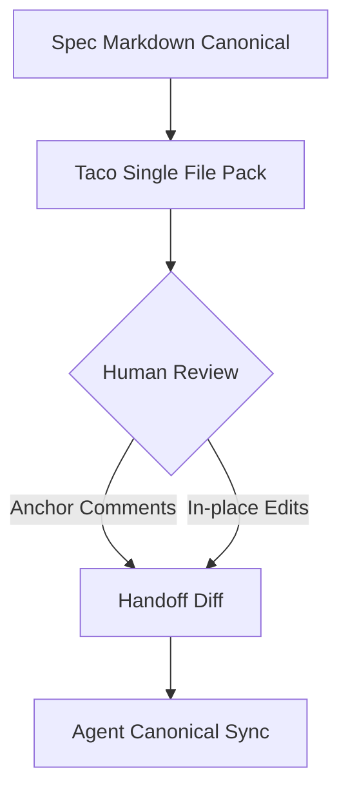
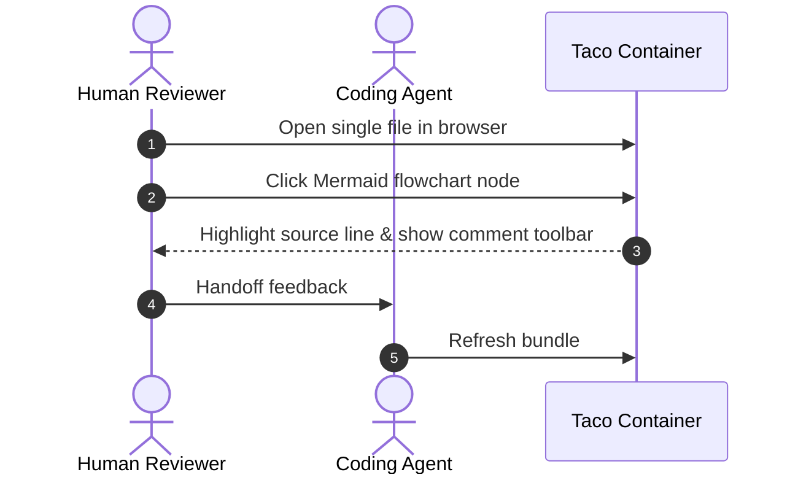

## Overview

This specification demonstrates Taco's single-file specification review capabilities, featuring rich Markdown documents, Checkpoints, and interactive Mermaid diagrams.

### Architecture Workflow

### Protocol Sequence Diagram

